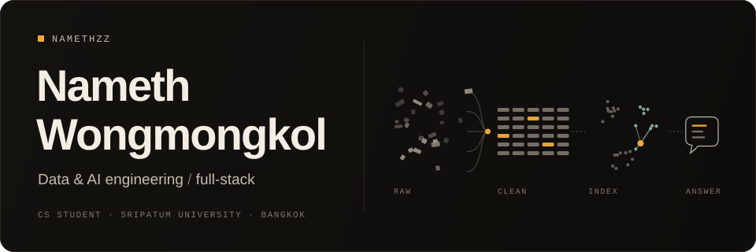
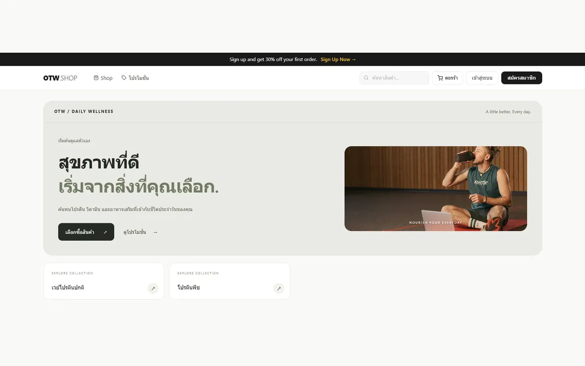
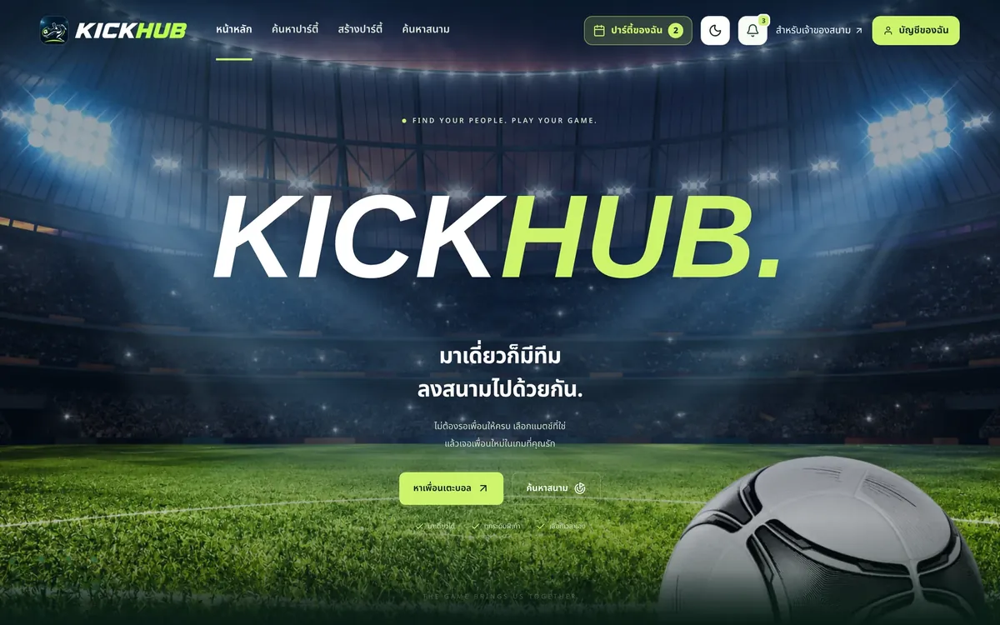
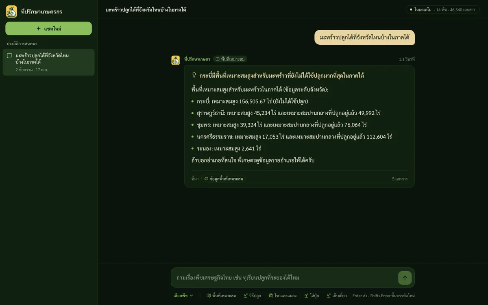
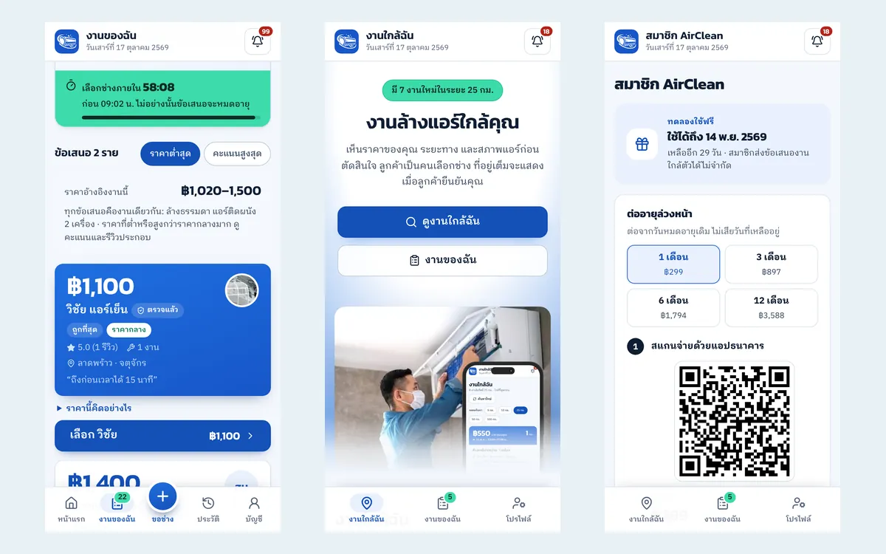
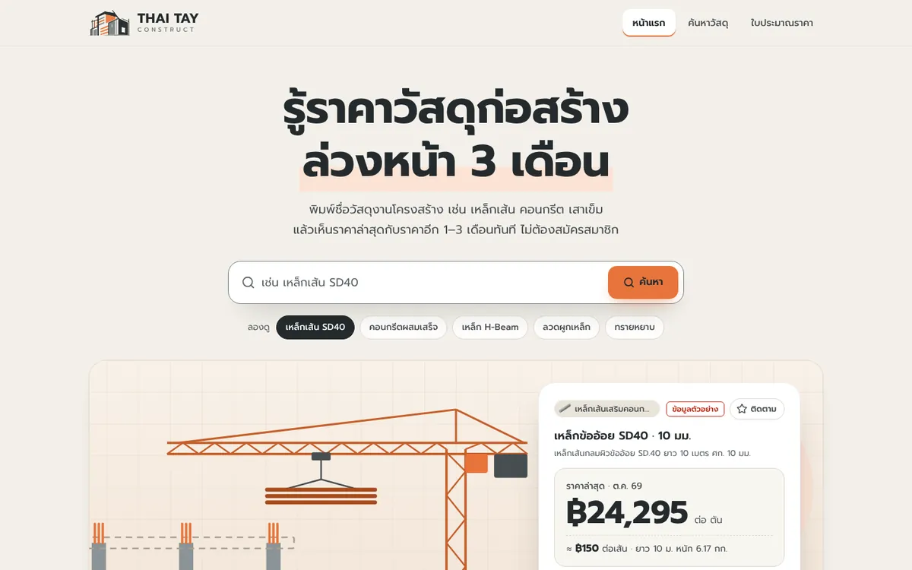

  <picture>
    <source media="(max-width: 600px)" srcset="./nameth-header-mobile.svg">
    
  </picture>

  <strong>Computer Science &amp; Software Development · Sripatum University</strong>
   
  Thailand &nbsp; · &nbsp; Open to internships in data analytics and software development

  <a href="mailto:nameth.won@spumail.net">Get in touch ↗</a>
  &nbsp;&nbsp; / &nbsp;&nbsp;
  <a href="https://github.com/namethzz?tab=repositories">All repositories ↗</a>

 

## About

I build web applications end to end: the database, the API, and the screens people use on their phones. I also like the data side, cleaning messy files until a model or a chart can use them.

The five projects below run from my second year to my fourth. I went back to the older ones in 2026, fixed what I could, and wrote down what I got wrong the first time. Each README explains how the project works and what is still missing.

 

## Projects

YEAR 2 &nbsp; / &nbsp; 01

<table>
  <tr>
    <td width="42%" valign="top">
      
    </td>
    <td valign="top">
      <h3><a href="https://github.com/namethzz/OTW">OTW (On The Whey) ↗</a></h3>
      
An online store for whey and plant protein. Customers browse, fill a cart, apply promotion codes and request returns. Admins manage products, orders, promotions and refunds.

      
I built it alone in year 2. In the 2026 review I hashed passwords, added CSRF checks, validated uploads, and moved checkout stock updates into one transaction so two buyers can't oversell. The README lists the mistakes I left in on purpose.

      
<code>C#</code> <code>ASP.NET Core MVC</code> <code>MySQL</code> <code>EF Core</code> <code>Docker</code>

      
<a href="https://otw-production.up.railway.app">Live site ↗</a>

    </td>
  </tr>
</table>

YEAR 2 &nbsp; / &nbsp; 02

<table>
  <tr>
    <td width="42%" valign="top">
      
    </td>
    <td valign="top">
      <h3><a href="https://github.com/namethzz/kickhub">KickHub ↗</a></h3>
      
Find people to play football with. Players search open games by date, budget and field, then ask to join. Hosts pick a mode (open "buffet" or fixed positions GK/DF/MF/FW), approve requests and chat with the team. Field owners list their own pitches.

      
Google and Facebook sign-in, account deletion in one MongoDB transaction, and 101 automated tests that run on every pull request.

      
<code>React</code> <code>TypeScript</code> <code>Node.js</code> <code>Express</code> <code>MongoDB</code> <code>GitHub Actions</code>

      
<a href="https://kickhub-web.onrender.com/home">Live site ↗</a>

    </td>
  </tr>
</table>

YEAR 3 &nbsp; / &nbsp; 03 &nbsp; · &nbsp; TEAM PROJECT

<table>
  <tr>
    <td width="42%" valign="top">
      
    </td>
    <td valign="top">
      <h3><a href="https://github.com/namethzz/chatbot-project">Economic Crops Chat ↗</a></h3>
      
A Thai chatbot for 14 economic crops. You ask where a crop grows well, how to plant it, or which diseases hit it, and the bot answers from Thai government data with sources (RAG).

      
<strong>My part:</strong> the data. I turned 4,000+ CSV files into search documents: 45,746 land-suitability records across 77 provinces and 97 pest and disease entries. I fixed misplaced files, misspelled crop names and Thai characters that look the same but aren't.

      
<code>Python</code> <code>FastAPI</code> <code>ChromaDB</code> <code>bge-m3</code> <code>React</code> <code>Node.js</code> <code>MongoDB</code>

      
<a href="https://chatbot-project-phi-nine.vercel.app">Live demo ↗</a> (demo mode with prepared answers)

    </td>
  </tr>
</table>

YEAR 4 &nbsp; / &nbsp; 04

<table>
  <tr>
    <td width="42%" valign="top">
      
    </td>
    <td valign="top">
      <h3><a href="https://github.com/namethzz/Air-clean-">AirClean ↗</a></h3>
      
A marketplace for air-conditioner cleaning. A customer posts one request, nearby technicians send quotes from their own price sheets, and the customer picks one within an hour. Technicians see the real address only after they win the job.

      
Four user roles, live technician tracking on a map, Web Push written from the RFCs with no library, and monthly technician fees paid by PromptPay QR with automatic slip checks against the bank.

      
<code>React</code> <code>TypeScript</code> <code>ASP.NET Core 8</code> <code>MongoDB</code> <code>PWA</code> <code>xUnit</code>

      
<a href="https://aircare-connect-web.onrender.com">Live site ↗</a>

    </td>
  </tr>
</table>

YEAR 4 &nbsp; / &nbsp; 05 &nbsp; · &nbsp; IN PROGRESS

<table>
  <tr>
    <td width="42%" valign="top">
      
    </td>
    <td valign="top">
      <h3><a href="https://github.com/namethzz/THAITAY">THAI TAY ↗</a></h3>
      
Know construction material prices three months ahead. You type a structural material such as rebar or ready-mix concrete, see the latest price and a 1 to 3 month forecast, then add it to a cost estimate you can print or send over LINE.

      
The web app works today with 287 materials in 9 categories. The forecasting model and the backend are next, so every price on the site today is labeled as demo data.

      
<code>React</code> <code>TypeScript</code> <code>Vite</code> <code>Python</code> <code>Pandas</code>

      
<a href="https://thaitay.vercel.app">Live demo ↗</a>

    </td>
  </tr>
</table>

 

## Skills & tools

| Area | Technologies |
| :--- | :--- |
| **Data & analysis** | Python · Pandas · NumPy · SQL · Looker Studio |
| **Frontend** | React · TypeScript · JavaScript · Vite · Tailwind CSS · Razor |
| **Backend** | C# · ASP.NET Core · Node.js · Express · FastAPI |
| **Databases** | MongoDB · MySQL · SQL Server · ChromaDB · SQLite |
| **Deploy** | Docker · GitHub Actions · Render · Vercel · Railway |

### Tools

  
  &nbsp;
  
  &nbsp;
  
  &nbsp;
  
  &nbsp;
  
  &nbsp;
  

 

## Currently learning

- **Machine learning for time series**, to forecast material prices in THAI TAY
- **SQL**: queries and database fundamentals
- **Data visualization**: charts and dashboards people can read at a glance

 

## GitHub Stats

  
  &nbsp;
  

 

## Let's connect

  Open to internships in data analytics and software development.

  
  &nbsp;&nbsp;
  

  
    <a href="mailto:nameth.won@spumail.net">nameth.won@spumail.net</a>
    &nbsp; / &nbsp;
    <a href="https://github.com/namethzz">@namethzz</a>
  

